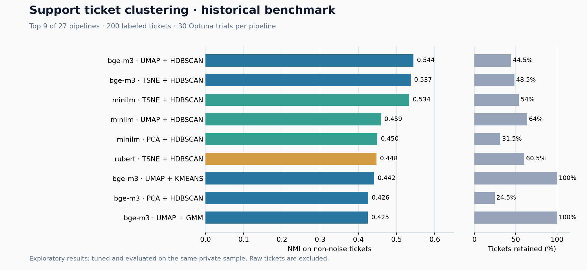

# Support Ticket Clustering

[](https://github.com/SashOk2802/support-ticket-clustering/actions/workflows/ci.yml)

Research pipeline for clustering Russian-language support tickets, developed during a university internship. It compares **27 combinations** of embedding models, dimensionality reduction and clustering, tunes parameters with Optuna, extracts cluster keywords and exports annotated datasets.

[Русский README](README.md) · [Historical results](docs/RESULTS.md)

## Run the offline demo

Use **Python 3.12**. Create and activate a virtual environment, then:

```bash
python -m pip install -r requirements-demo.txt
python apply_pipeline.py --demo
```

The demo uses **TF-IDF → PCA → K-Means** and 32 entirely fictional tickets. It needs neither API credentials nor model downloads after dependency installation. Results are written to `results/inference/`: annotated CSV, cluster summaries in CSV/XLSX and a JSON run summary. `requirements-lock-demo.txt` records the tested Python 3.12 demo environment.

## NLP pipeline and benchmark

```bash
python -m pip install -r requirements.txt
python apply_pipeline.py --input datasets/my_tickets.csv --model minilm --dim umap --cluster hdbscan --min-cluster-size 10
python experiment.py --input datasets/demo_tickets.csv --models rubert --dim-methods pca --cluster-methods kmeans --trials 5
```

The full benchmark defaults to 30 Optuna trials for each of 27 combinations:

| Stage | Options |
|---|---|
| Embedding model | BGE-M3, multilingual MiniLM, ruBERT-tiny2 |
| Dimensionality reduction | UMAP, PCA, t-SNE |
| Clustering | HDBSCAN, K-Means, Gaussian Mixture Model |

CSV and XLSX inputs need a `text` column. `category` enables evaluation against reference labels; `ticket_id` is optional. Empty texts retain their row positions with cluster `-2`; HDBSCAN noise is `-1`. The embedding cache includes the model and the exact ordered texts. Each run clusters its input dataset anew; cluster IDs are not stable category identifiers.

Hugging Face models download on first use and run locally. Full dependencies include PyTorch. Use `--help` for all CLI options.

## Historical findings and limitations

The original exploratory experiment used **200 labeled private tickets**, with 30 trials per pipeline. Its highest NMI was **0.5445** for **BGE-M3 → UMAP → HDBSCAN** (ARI **0.2867**, silhouette **0.5169**).



**Metrics exclude noise.** The leading pipeline labeled only **44.5%** of the sample; **55.5%** was noise. Hyperparameters were tuned and evaluated on the same small dataset, without a holdout set. These are exploratory results, not evidence of production accuracy on unseen tickets. They were preserved from the original version; the complete historical benchmark was not rerun after publication fixes. The private sample is excluded, so those exact numbers cannot be independently reproduced from this repository. [All metrics and methodology](docs/RESULTS.md).

## Privacy and optional LLM labels

Only fictional tickets and aggregate metrics are public. Raw tickets, credentials, academic reports, embeddings and detailed outputs are excluded. Preprocessing cleans whitespace and joins the subject to the first user message; it does **not** anonymize text.

LLM labels are disabled by default. Configure a local `.env` using `.env.example`. The default endpoint is **OpenRouter**, so `OPENAI_API_KEY` must contain an OpenRouter key. Override `OPENAI_BASE_URL` and `OPENAI_MODEL` for another compatible provider.

```bash
python apply_pipeline.py --demo --llm-labels --allow-text-upload
```

Both flags are required. This mode sends cluster keywords and up to three ticket examples per cluster to the selected provider and may incur API costs. Use only data you are permitted to share. Without these flags, the application makes no LLM requests.

The publication audit checks an explicit file allowlist and credential/contact/path patterns in staged files and reachable Git history. Pattern matching supplements manual review; it cannot prove arbitrary private data is absent. See [SECURITY.md](SECURITY.md).

## Development

```bash
python -m pip install -r requirements-dev.txt
python -m pytest -q
python -m ruff check .
python -m ruff format --check .
python scripts/check_publication.py --history
```

CI tests the credential-free demo and regression cases on Windows and Linux. Full transformer downloads and paid LLM calls are not part of CI.

[MIT license](LICENSE) applies to this code and fictional demo. Third-party datasets and models retain their own licenses.
