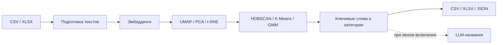

# Support Ticket Clustering

[](https://github.com/SashOk2802/support-ticket-clustering/actions/workflows/ci.yml)

[](LICENSE)

**Кластеризация русскоязычных обращений в техническую поддержку:** от подготовки текстов до поиска тем, сравнения алгоритмов и экспорта результатов.

[English README](README.en.md) · [Результаты эксперимента](docs/RESULTS.md) · [Работа с данными](datasets/README.md)

Проект разработан в рамках университетской ознакомительной практики. Задача — исследовать, как автоматически группировать похожие обращения и получать понятные категории без обучения классификатора на фиксированном наборе классов.

## Что реализовано

- Сравнение **27 пайплайнов**: 3 модели эмбеддингов × 3 метода снижения размерности × 3 алгоритма кластеризации.
- Подбор гиперпараметров через **Optuna** с учётом NMI, доли шума и числа кластеров.
- Извлечение ключевых слов через TF-IDF по объединённым текстам кластеров.
- Опциональные названия категорий через LLM; по умолчанию используются локальные ключевые слова.
- Кэш эмбеддингов с проверкой модели, содержания и порядка текстов.
- Экспорт размеченных обращений, сводки кластеров и метрик в CSV, XLSX и JSON.
- Вымышленный демодатасет, тесты и CI на Windows и Linux.



## Быстрый запуск

Нужен **Python 3.12**. Демо работает на CPU без API-ключей и загрузки моделей; интернет нужен только для установки зависимостей.

```bash
git clone https://github.com/SashOk2802/support-ticket-clustering.git
cd support-ticket-clustering
python -m venv .venv
```

Активация в PowerShell:

```powershell
.\.venv\Scripts\Activate.ps1
```

Активация в Linux/macOS:

```bash
source .venv/bin/activate
```

```bash
python -m pip install -r requirements-demo.txt
python apply_pipeline.py --demo
```

Демо использует **TF-IDF → PCA → K-Means** на 32 вымышленных обращениях про оплату, DNS, серверы и почту. Это лёгкий пример работы программы; его метрики не заменяют исследование на реальных обращениях.

В `results/inference/` появятся:

| Файл | Содержимое |
|---|---|
| `annotated_dataset.csv` | Исходные строки, номер и название кластера |
| `cluster_summary.csv` / `.xlsx` | Размеры кластеров, ключевые слова, примеры |
| `run_summary.json` | Конфигурация запуска и метрики при наличии `category` |

Для точного воспроизведения проверенного демоокружения можно установить `requirements-lock-demo.txt` вместо `requirements-demo.txt`. Локальная проверка выполнена на Windows с Python 3.12.14.

## Основной NLP-пайплайн

```bash
python -m pip install -r requirements.txt
python apply_pipeline.py --input datasets/my_tickets.csv --model minilm --dim umap --cluster hdbscan --min-cluster-size 10
```

Вход — CSV с запятой, `;` или табуляцией либо XLSX. Нужна колонка `text`; другое имя задаётся через `--text-column`. `ticket_id` необязателен, `category` нужен только для расчёта ARI/NMI. Пустые строки сохраняются с `cluster = -2`; шум HDBSCAN обозначается `-1`.

| Компонент | Варианты |
|---|---|
| Эмбеддинги | `bge-m3`, `minilm`, `rubert`; `tfidf` для лёгкого локального примера |
| Снижение размерности | `umap`, `pca`, `tsne` |
| Кластеризация | `hdbscan`, `kmeans`, `gmm` |

Модели Sentence Transformers загружаются с Hugging Face при первом запуске, затем кодирование и кластеризация выполняются локально. Полный набор зависимостей включает PyTorch и требует больше места, чем демо. Список параметров: `python apply_pipeline.py --help`.

Каждый запуск заново группирует переданный набор текстов. Это исследовательская кластеризация: номера кластеров между разными запусками не являются постоянными идентификаторами категорий.

## Эксперимент

Для короткого прогона на вымышленных размеченных данных:

```bash
python experiment.py --input datasets/demo_tickets.csv --models rubert --dim-methods pca --cluster-methods kmeans --trials 5
```

Для всех 27 комбинаций на своей размеченной выборке:

```bash
python experiment.py --input datasets/my_labeled_tickets.csv --trials 30
```

Полный эксперимент может занять значительное время. Optuna максимизирует `NMI − max(0, noise_pct − 40) × 0.004 − 0.15`, где последний штраф применяется при числе кластеров меньше трёх. В итоговой таблице также сохраняется `Optuna_Score`; историческое сравнение ранжировано по NMI.

### Сохранённые результаты исходного исследования

Исходная версия сравнила 27 комбинаций на **200 размеченных обращениях**, по 30 попыток Optuna на комбинацию. В публичной версии сохранены только агрегированные показатели.

| Пайплайн | NMI | ARI | Шум |
|---|---:|---:|---:|
| BGE-M3 → UMAP → HDBSCAN | **0.5445** | **0.2867** | **55.5%** |
| BGE-M3 → t-SNE → HDBSCAN | 0.5371 | 0.1225 | 51.5% |
| MiniLM → t-SNE → HDBSCAN | 0.5336 | 0.1531 | 46.0% |


**Ограничения:** ARI/NMI посчитаны только по обращениям вне шума. У лидера остаётся 44.5% выборки. Параметры подбирались и оценивались на одной небольшой выборке, без отдельного holdout-набора. Эти числа описывают поисковый эксперимент, а не качество промышленной системы на новых данных. После подготовки публичной версии весь исходный эксперимент не пересчитывался. [Подробности и все 27 строк](docs/RESULTS.md).

## Опциональные LLM-названия

Создай локальный `.env` из `.env.example`. Значения можно также передать через переменные окружения. По умолчанию задан OpenRouter: нужен ключ **OpenRouter**, несмотря на совместимое имя переменной `OPENAI_API_KEY`. Адрес и модель задаются через `OPENAI_BASE_URL` и `OPENAI_MODEL`.

```bash
python apply_pipeline.py --demo --llm-labels --allow-text-upload
```

Этот режим отправляет ключевые слова и до трёх примеров обращений из каждого кластера провайдеру LLM и может расходовать средства на API. Оба флага должны быть включены явно; используй только данные, которые разрешено передавать. Без них запросы к LLM не выполняются.

## Данные и безопасность

Оригинальные обращения, ключи, эмбеддинги, подробные результаты и учебные отчёты не включены в репозиторий. Публичный датасет написан с нуля и содержит только вымышленные обращения.

`preprocessing.py` объединяет тему с первым пользовательским сообщением в порядке исходного файла и очищает пробелы. Он **не обезличивает** тексты. После подготовки своей выборки добавь колонку `category`, если нужен benchmark. Подробная схема входных файлов есть в [datasets/README.md](datasets/README.md).

Локальные данные в `datasets/`, результаты в `results/`, `.env` и архивы исключены через `.gitignore`. Дополнительно `scripts/check_publication.py --history` проверяет список публикуемых файлов и типичные признаки секретов в индексе и истории Git. Такая проверка дополняет ручной просмотр; она не гарантирует автоматическое обнаружение любых персональных данных. См. [SECURITY.md](SECURITY.md).

## Проверка кода

```bash
python -m pip install -r requirements-dev.txt
python -m pytest -q
python -m ruff check .
python -m ruff format --check .
python scripts/check_publication.py --history
```

Тесты покрывают чтение CSV, подготовку обращений, корректность кэша, малые выборки, шум, извлечение слов и запрет включения LLM без явного разрешения отправки текстов. Демо проверяется с отключённым доступом Hugging Face и без ключей.

## Структура

```text
apply_pipeline.py         Запуск кластеризации и экспорт
experiment.py             Алгоритмы, метрики и Optuna benchmark
preprocessing.py          Подготовка локальных обращений
io_utils.py               Чтение и проверка датасетов
datasets/demo_tickets.csv  Вымышленные данные для демонстрации
docs/                     Агрегированные исторические результаты
scripts/                  График и проверка публикации
tests/                    Регрессионные тесты
.github/workflows/ci.yml   Проверки Windows / Linux
```

Код и синтетическое демо распространяются под [MIT](LICENSE). Права на локальные сторонние данные и модели определяются их владельцами и лицензиями.
